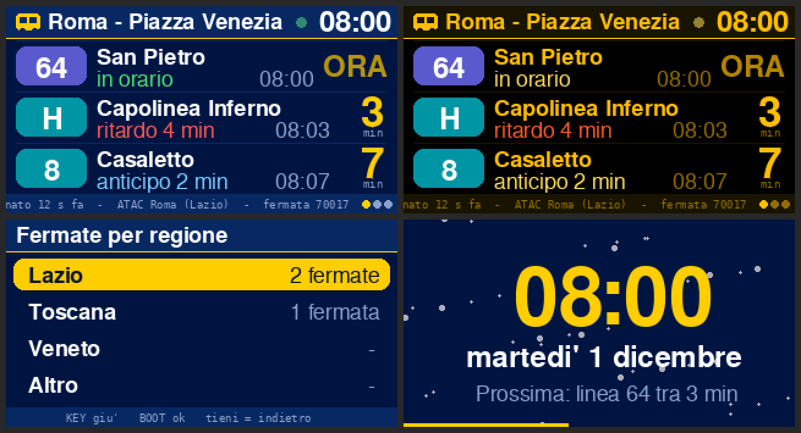

# 🚏 Fermata – tabellone partenze per LilyGO T‑Display S3

Un piccolo tabellone delle partenze in tempo reale per la scrivania. Usa i feed
GTFS‑Realtime degli operatori italiani, organizzati per regione.




*Anteprime generate da un simulatore sul PC: sul display reale i font e
l'orologio a 7 segmenti sono leggermente diversi.*

- **Animazione di avvio**: cielo stellato, binari tricolore, un treno che entra in
  stazione e frena, la scritta *FERMATA* che cade lettera per lettera e il saluto
  personalizzato.
- **Sorpresa al primo avvio**: coriandoli, un pacchetto regalo che si apre, il
  nome di chi lo riceve e un messaggio a scelta. Si può rivedere dal menù.
- **Tabellone**: badge colorato della linea, destinazione (se il feed la fornisce),
  puntualità (*in orario*, *ritardo 3 min*, *anticipo*), minuti che scorrono in
  tempo reale, *ORA* lampeggiante quando il bus arriva, più pagine con
  transizione, orologio e indicatore *live*.
- **Menù a due tasti**: fermate per regione, orologio, 4 temi, luminosità,
  rotazione, informazioni, demo, reset.
- **Configurazione dal telefono** su `http://fermata.local`: fermate preferite,
  nome, messaggio, tema.
- **Modalità demo** che funziona anche senza WiFi: utile per provarlo prima di
  incartarlo.

## Regioni e operatori

| Regione | Operatore | Chiave feed |
|---|---|---|
| Lazio | ATAC Roma | `atac_roma` |
| Toscana | Autolinee Toscane | `toscana` |
| Veneto | ACTV Venezia | `actv_veneto` |
| Veneto | Busitalia Padova | `busitalia_veneto` |
| Veneto | Tram Padova | `busitalia_tram` |
| Altro | qualsiasi URL GTFS‑RT TripUpdates | `custom` |

Per aggiungere un operatore basta una riga in `kFeeds` (`config.h`) e, se usi il
proxy, la stessa chiave in `proxy.php`. L'ordine di `kFeeds` è l'ordine delle
regioni nei menù.

## Tasti

I tasti sono **BOOT** (GPIO0) e **KEY** (GPIO14).

| Dove | BOOT | KEY | Tenere premuto |
|---|---|---|---|
| Tabellone | apre il menù | fermata preferita successiva | BOOT: orologio · KEY: aggiorna ora |
| Menù | OK | giù | indietro |
| Configurazione WiFi | modalità demo | – | – |
| Orologio, pagine | torna indietro | torna indietro | torna indietro |

## Installazione (Arduino IDE)

1. **Scheda**: in *Preferenze → URL aggiuntivi* aggiungi
   `https://raw.githubusercontent.com/espressif/arduino-esp32/gh-pages/package_esp32_index.json`,
   poi da *Gestore schede* installa **esp32 di Espressif versione 2.0.17**
   (è quella provata in CI; TFT_eSPI con le versioni 3.x dà problemi sul bus
   parallelo della S3).
2. **Librerie** (*Gestore librerie*): **TFT_eSPI** 2.5.43 di Bodmer e
   **WiFiManager** 2.0.17 di tzapu.
3. **Configura TFT_eSPI per la T‑Display S3**: apri
   `Arduino/libraries/TFT_eSPI/User_Setup_Select.h`, commenta
   `#include <User_Setup.h>` e togli il commento a
   `#include <User_Setups/Setup206_LilyGo_T_Display_S3.h>`.
   Se te lo dimentichi lo schermo resta nero; in compilazione vedrai un avviso.
4. Apri `fermata/fermata.ino`, scegli la scheda **LilyGo T‑Display‑S3**,
   *PSRAM: OPI PSRAM*, e carica.

Ogni push su GitHub compila il firmware (vedi *Actions*); il `.bin` si scarica
dagli artefatti della build.

## Prepararlo come regalo 🎁

Puoi farlo prima di flashare, in `config.h`:

```cpp
#define GIFT_NAME "Marco"
#define GIFT_MESSAGE "Buon viaggio, ogni giorno!"
#define DEFAULT_FAVORITES "Sotto casa|atac_roma|70017;Ufficio|atac_roma|70123"
```

oppure dopo, da `http://fermata.local` (c'è anche la casella *mostra di nuovo
la sorpresa al prossimo avvio*, così puoi provarlo tu e lui la vede
comunque).

Checklist:
1. Flasha, guarda l'animazione, premi un tasto dopo la sorpresa.
2. Senza WiFi: premi BOOT nella schermata WiFi e prova la **modalità demo**.
3. Con il tuo WiFi: aggiungi le sue fermate da `http://fermata.local` e
   controlla che arrivino le partenze.
4. Dal sito spunta *mostra di nuovo la sorpresa* e salva. Poi
   **Menù → Reset → Cancella solo il WiFi**: così, quando lui lo accende a casa
   sua, vede animazione, sorpresa e poi la schermata per collegarlo al suo WiFi
   (rete `Fermata-Setup` dal telefono).

## Come trovo l'ID della fermata?

Serve lo `stop_id` del GTFS statico dell'operatore:
- cerca la fermata su [transit.land](https://www.transit.land) (operatore →
  fermata) e copia lo *stop_id*;
- oppure scarica il GTFS statico dell'operatore e cerca il nome in `stops.txt`;
- per ATAC di solito è il numero della palina scritto sulla fermata.

Se una fermata ha un ID per direzione, mettili entrambi separati da virgola.

## Lombardia: orari Trenord e ATM (programmati)

In Lombardia non ci sono feed in tempo reale aperti a tutti, ma Regione
Lombardia pubblica il **GTFS statico** di Trenord. `proxy.php` (insieme a
`gtfs_static.php`) lo importa in un piccolo database e risponde con le
prossime partenze nello stesso formato GTFS‑RT: sul display compaiono con la
scritta *orario programmato* invece di *in orario*.

- Serve l'**URL del proxy** nella pagina `fermata.local`.
- Per trovare l'ID di una stazione: apri
  `https://<il-tuo-proxy>/proxy.php?feed=trenord&search=Milano` e copia l'`id`.
  Si può mettere anche l'ID della stazione "madre": il proxy include tutti i
  suoi binari.
- ATM Milano funziona allo stesso modo (`feed=atm`); le linee della metro
  compaiono come M1…M5. Il file ATM nel repo va sostituito quando ATM ne
  pubblica uno nuovo (ogni versione ha una data di scadenza).
- Il Dockerfile prepara gli orari durante il deploy (o usa `gtfs/trenord.zip`
  se è nel repo) e il proxy li riscarica da solo ogni settimana.

## Feed con password (Busitalia Padova)

Il feed dei bus di Busitalia Veneto (Padova) chiede **utente e
password** (HTTP Basic). Le credenziali vanno chieste a Busitalia Veneto, che
le dà a chi usa i dati aperti; poi si scrivono nella sezione *Accesso ai feed*
di `http://fermata.local`. Se mancano o sono sbagliate, il display scrive
*Servono utente e password*. Con il proxy invece si impostano sul server, per
esempio `FEED_AUTH_BUSITALIA_VENETO=utente:password` e
`FEED_AUTH_BUSITALIA_TRAM=utente:password`.

## Proxy (facoltativo, ma consigliato per feed grandi)

Il display scarica e decodifica il feed in streaming, quindi funziona anche senza
server. Il feed però è di tutta la regione e può pesare qualche MB a ogni
aggiornamento. Se pubblichi `proxy.php` (c'è il `Dockerfile` nella radice del
repo) e ne metti l'URL nella pagina di configurazione, il display chiede
`proxy.php?feed=toscana&stops=ID` e riceve solo le corse delle sue fermate,
pochi KB. Il proxy tiene il feed in cache per 15 secondi.

## Limiti

- I feed GTFS‑RT contengono la linea (`route_id`) ma quasi mai la destinazione:
  se manca, il display scrive *Linea X*. Su alcuni feed il `route_id` è un
  codice interno e non il numero che vedi sul bus.
- Una corsa che ha solo il ritardo senza l'orario richiederebbe l'orario
  statico, quindi non viene mostrata.
- Il certificato HTTPS dei feed non viene verificato (sono dati pubblici e il
  display non invia nulla di riservato).

## Test

`sh tools/test_gtfsrt.sh` compila il parser sul PC e lo prova su un feed
sintetico (serve `pip install gtfs-realtime-bindings`); se c'è `php`, prova
anche il filtro del proxy.
